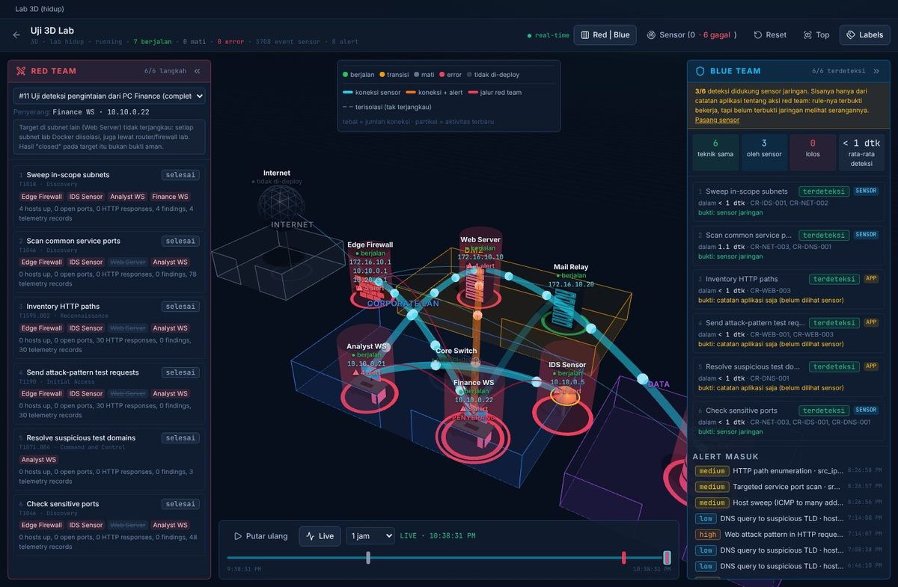
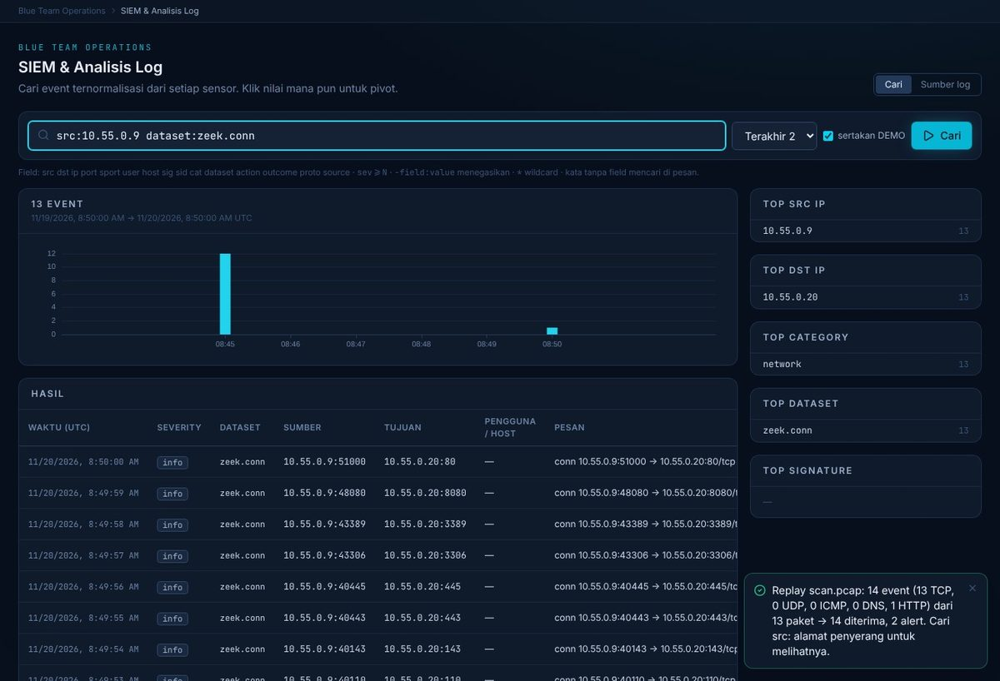
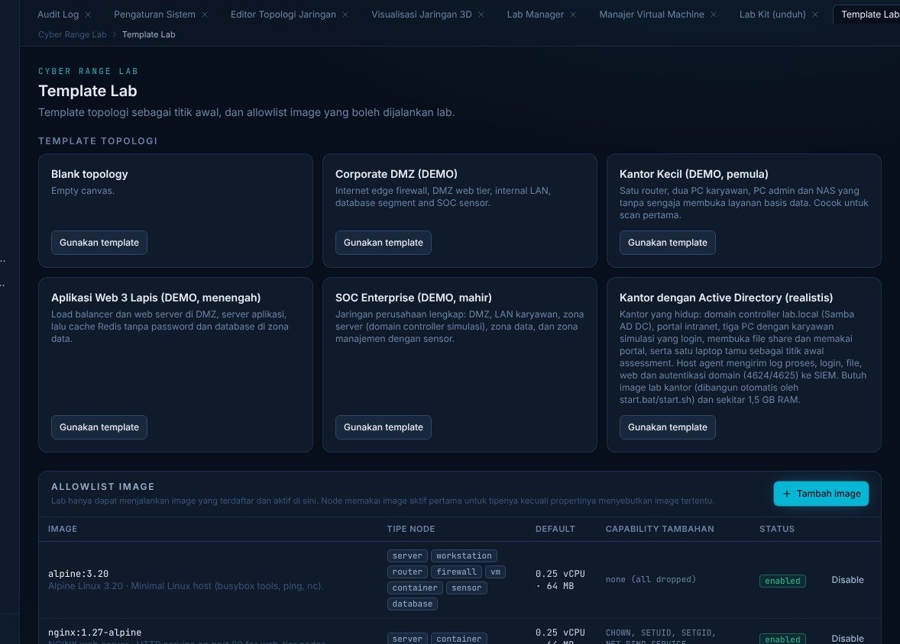

# Cyber Range (Edisi Lokal)

Lab latihan keamanan siber yang berjalan di laptop Anda sendiri. Anda membangun jaringan kantor kecil, menyerangnya
dari satu sisi, lalu memeriksa dari sisi lain apakah pertahanan Anda melihat serangan itu. Semua berjalan di jaringan
Docker yang terkunci, tanpa akses ke internet atau ke jaringan rumah dan kantor Anda. Antarmuka dan modulnya berbahasa
Indonesia.



*Satu assessment di lab "Uji 3D": enam langkah serangan di panel kiri. Panel kanan menunjukkan rule yang menangkap
tiap langkah, berapa detik kemudian, dan apakah buktinya datang dari sensor jaringan atau hanya dari catatan aplikasi.*

## Untuk siapa

* **Pelajar dan mahasiswa** yang sudah membaca tentang SOC, SIEM, atau MITRE ATT&CK dan ingin melihatnya bekerja.
* **Pengajar** yang butuh lab praktik. Setiap peserta menjalankan salinannya sendiri, jadi Anda tidak perlu mengurus
  server bersama.
* **Analis SOC** yang ingin menguji rule deteksi terhadap lalu lintas sungguhan sebelum memakainya di tempat kerja.

Anda tidak perlu jago Linux. Kalau bisa memasang Docker Desktop dan mengklik dua kali sebuah berkas, Anda bisa mulai.

## Seperti apa satu sesi latihan

1. Pilih template **Kantor Kecil**: satu router, dua PC karyawan, satu PC admin, dan NAS yang tanpa sengaja membuka
   layanan database.
2. Klik **Deploy**. Aplikasi membuat container untuk setiap perangkat, lengkap dengan alamat IP dan subnetnya.
3. Pasang sensor **Zeek** dan **Suricata** dari tampilan 3D dengan satu klik.
4. Ajukan assessment red team: pilih penyerang, pilih target, setujui jendela waktunya, lalu jalankan. Aksinya nyata
   (pemindaian host dan port, permintaan HTTP, kueri DNS), tetapi terbatas pada katalog yang tidak merusak.
5. Tonton panel Blue. Setiap langkah berakhir sebagai **terdeteksi**, **rule lain**, atau **LOLOS**.
6. Untuk langkah yang lolos, tulis rule baru atau impor rule **Sigma**, lalu ulangi. Rule yang sama juga bisa Anda uji
   pada file **.pcap** dari Wireshark.



## Isi aplikasi

| Bagian | Yang bisa Anda lakukan |
|---|---|
| **Lab** | Menyusun topologi di editor visual atau mulai dari 5 template siap pakai, termasuk kantor dengan Active Directory (Samba AD), portal intranet, dan karyawan simulasi yang login sungguhan |
| **Red team** | Menjalankan 8 skenario serangan terotorisasi ke node lab Anda sendiri. Setiap langkah tercatat dengan teknik ATT&CK-nya |
| **Blue team** | Mencari log di SIEM, mengelola alert dan insiden, menjalankan playbook SOAR, memantau SLA. Ada 21 rule bawaan, dan Anda bisa menulis atau mengimpor sendiri |
| **Purple team** | Melihat serangan dan deteksi berdampingan di tampilan 3D. Timeline bisa diputar ulang, dari 15 menit sampai 24 jam |
| **Intelijen dan forensik** | Threat intelligence, manajemen kerentanan, analisis malware statis dengan YARA, dan barang bukti dengan chain of custody |
| **Latihan** | Soal CTF dan misi bertahap |
| **Lab Kit** | Mengekspor lab ke Docker Compose atau Vagrant, termasuk versi dengan Windows Server dan Windows 11 Evaluation |



## Memulai

**Yang Anda perlukan**

* Docker Desktop (Windows atau macOS), atau Docker Engine dengan Compose v2 (Linux).
* RAM kosong sekitar 4 GB. Template kantor dengan Active Directory butuh tambahan sekitar 1,5 GB.
* Internet saat pertama kali menjalankan, untuk mengunduh image. Setelah itu lab tidak butuh internet.

**Windows**

1. Buka Docker Desktop, tunggu sampai muncul *Engine running*.
2. Ekstrak ZIP, lalu klik dua kali `start.bat`.
3. Pertama kali butuh 5 sampai 15 menit. Browser akan terbuka sendiri di `http://localhost:8080`.

Untuk berhenti, klik dua kali `stop.bat`. Data Anda tetap tersimpan.

**Linux dan macOS**

```
./start.sh
```

Berhenti dengan `docker compose down`.

`start.bat` dan `start.sh` membuat file `.env` berisi password acak khusus komputer Anda. Bila port 8080, 3306, atau
6379 sudah dipakai program lain, keduanya memindahkan port aplikasi ini dan menampilkan port barunya.

Tidak ingin memasang Docker di komputer utama? Jalankan semuanya di dalam satu VM: masuk ke folder `vm` lalu
`vagrant up`. Rinciannya ada di `vm/README.md`.

Ingin data contoh untuk dijelajahi dulu? Jalankan `docker compose --profile demo run --rm demo-seed`. Semua data contoh
berlabel **DEMO** di layar.

## Belajar memakainya

Folder `docs/` berisi **Modul-Cyber-Range-Edisi-Lokal.pdf**, sekitar 70 halaman bergambar untuk pemula. Isinya konsep
dasar red, blue, dan purple team, cara memasang, tur setiap halaman, lima latihan terpandu, cara membaca hasil deteksi,
dan daftar masalah umum beserta solusinya.

Kalau sesuatu gagal saat dijalankan, ikuti `UJI-DI-KOMPUTER-ANDA.md`. Panduan itu menyebut perintah yang harus Anda
jalankan dan hasil yang perlu dikirim saat melapor.

## Sebelum Anda memakainya

* **Satu pengguna, satu komputer.** Edisi ini tidak punya login. Siapa pun yang bisa membuka `localhost` di komputer
  Anda bisa memakainya. Jangan membuka port aplikasi ke jaringan lain.
* **Serangannya sungguhan, ruang lingkupnya sempit.** Aksi red team hanya menyentuh node lab yang dibuat aplikasi ini,
  dan hanya dalam jendela waktu yang Anda setujui. Mengarahkan alat seperti ini ke sistem milik orang lain bisa
  membawa Anda ke urusan hukum. Baca `PENGGUNAAN-ETIS.md`.
* **Lencana APP dan SENSOR punya arti berbeda.** APP berarti aplikasi mencatat aksinya sendiri dan rule Anda
  menangkap catatan itu. Rule-nya terbukti benar, tetapi jaringan belum tentu melihat serangannya. Pasang sensor untuk
  mendapat bukti SENSOR.
* **Subnet lab saling terisolasi.** Docker memisahkan setiap subnet di host, juga dari router lab. Pemindaian ke subnet
  lain menghasilkan "closed", dan itu tidak berarti targetnya aman. Tampilan 3D menandai target seperti ini sebagai
  *terisolasi*.
* **VM Windows sungguhan masih eksperimental.** Secara bawaan, node bertipe VM berjalan sebagai container yang
  diperketat. Jalur KVM/libvirt untuk Windows asli ada di `VM-WINDOWS.md`, tetapi belum diuji menyeluruh.

## Keamanan

* Aplikasi hanya mendengarkan di `127.0.0.1`. Sesi hanya diberikan bila `Host` dan `Origin` adalah localhost, sehingga
  situs lain dan serangan DNS rebinding tertolak. Setiap penolakan tercatat dan memicu alert.
* Redis wajib memakai password. MySQL dan Redis juga hanya terbuka di `127.0.0.1`.
* **Token akses lokal** (opsional) membatasi sesi hanya untuk browser yang membawa token. Ini berguna bila komputer
  dipakai bersama. Aktifkan dengan `./scripts/init-env.sh --with-local-token`, lalu jalankan ulang. `start.bat` langsung
  membuka browser dengan tokennya. Di Linux dan macOS, buka sekali `http://localhost:8080/#cr-token=<nilai di .env>`.
* Lab worker memegang socket Docker, yang setara dengan akses root di host. Kalau bisa, jalankan aplikasi ini di
  komputer atau VM khusus untuk lab.

Menemukan celah keamanan? Laporkan secara pribadi sesuai `SECURITY.md`, jangan lewat issue publik.

## Teknologi

Frontend memakai Vue 3, Vite, Tailwind 4, dan Three.js. Backend memakai FastAPI, SQLAlchemy 2, dan Alembic, dengan
MySQL 8.4 LTS sebagai satu-satunya database serta Redis dan Celery untuk antrian. Lab memakai Zeek dan Suricata
sebagai sensor jaringan.

| Folder | Isi |
|---|---|
| `backend/` | API, worker, rule deteksi, katalog aksi red team |
| `frontend/` | Aplikasi web dan konfigurasi nginx |
| `lab-images/` | Image lab kantor (domain controller, portal, workstation) |
| `infrastructure/` | Konfigurasi MySQL dan sensor |
| `scripts/` | Pembuat `.env`, cadangan, dan pemulihan |
| `vm/` | Menjalankan seluruh aplikasi di dalam VM Vagrant |
| `docs/` | Modul belajar PDF dan gambar untuk README |

Tes backend: dari dalam container backend, jalankan `pip install -r requirements-dev.txt && pytest -q`.

## Lisensi

Kode di repositori ini memakai lisensi MIT (`LICENSE`). Komponen yang diunduh saat build, seperti MySQL, Redis,
Suricata, Zeek, dan Samba, memakai lisensinya masing-masing. Daftar lengkapnya ada di `THIRD-PARTY.md`.
